# Genuine native screenshot index

32 Android images; 0 iOS. Captured 2026-10-22 from the running Medium Phone Android 16/API 36.1 emulator, existing debug APK/runtime plus current branch JS. PNG bytes are adb screencap output, never generated mockups. Device serials/identities are omitted. No credentials, user GPS or private media were entered. Public catalog business addresses remain.

PASS below refers to the narrow observation, not an entire BLOCKED auth/backend/accessibility scenario. Failed pre-fix images are deliberately retained. Action names for crispiness and Wingman were corrected after inspecting actual state; the append-only action log retains attempted names. Legacy Welcome was recaptured after dismissing the dev menu; timestamp below is the final image. Launch captures use fresh UI polling; ordinary images also have XML in ../ui. SHA256 verifies each original PNG.

| Thumbnail / file | UTC capture | Device / state | Result / proves | SHA256 |
|---|---|---|---|---|
| [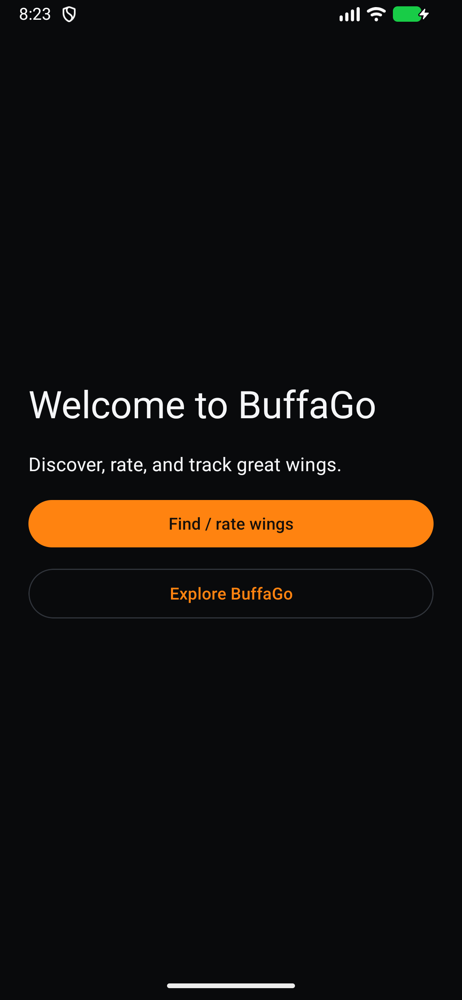](android-E2E-01-welcome.png) [android-E2E-01-welcome.png](android-E2E-01-welcome.png) | 2026-10-22T12:23:52.046Z | Android QA emulator 1170x2532 | **PASS** — Fresh-data V2 Welcome with Find/rate and Explore. | 21a5a4610aa8572b67b2af2156e94b2e7e58f6ca36c99697d3acbd65ed7dfaae |
|  [android-E2E-02-cold-launch-1.png](android-E2E-02-cold-launch-1.png) | 2026-10-22T12:24:26.512Z | Android QA emulator 1170x2532 | **PASS** — Consecutive process-cold launch reaches guest Home; no Welcome replay. | af6a2315c83d4faf81fa2f831c6222f8d8b2dcc3c5ea5e158ff9bea79c805946 |
| [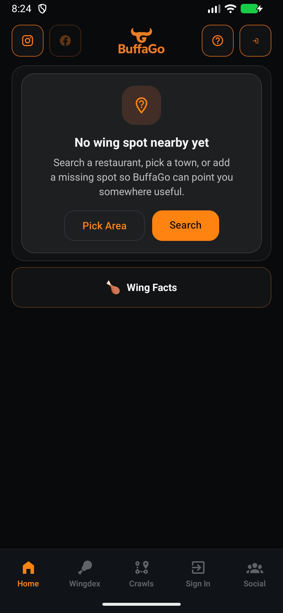](android-E2E-02-cold-launch-2.png) [android-E2E-02-cold-launch-2.png](android-E2E-02-cold-launch-2.png) | 2026-10-22T12:24:53.416Z | Android QA emulator 1170x2532 | **PASS** — Consecutive process-cold launch reaches guest Home; no Welcome replay. | e1af755793b5af424874e2bc4d46151ef9a46098ef861e2c938916e9c1079f8b |
|  [android-E2E-02-cold-launch-3.png](android-E2E-02-cold-launch-3.png) | 2026-10-22T12:25:09.177Z | Android QA emulator 1170x2532 | **PASS** — Consecutive process-cold launch reaches guest Home; no Welcome replay. | 0e85b2e6c467e1d4afbf6d979e48b1bd741b1daaa36262544414204460e1da3f |
|  [android-E2E-02-guest-home.png](android-E2E-02-guest-home.png) | 2026-10-22T12:24:02.915Z | Android QA emulator 1170x2532 | **PASS** — Explore arrives at usable guest Home. | e3f2abdeb75cc2e63fedcc740237bab9c11879d83495d36f05a2dba95536b437 |
| [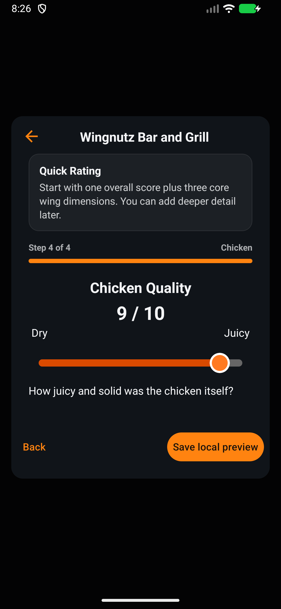](android-E2E-03-rating-chicken-9.png) [android-E2E-03-rating-chicken-9.png](android-E2E-03-rating-chicken-9.png) | 2026-10-22T12:26:28.967Z | Android QA emulator 1170x2532 | **PASS** — Shared step 4, chicken 9. | 579f162dfd15acb71fc80d1dbb82fc302536b9d7cb7a3847156c83d17902678c |
| [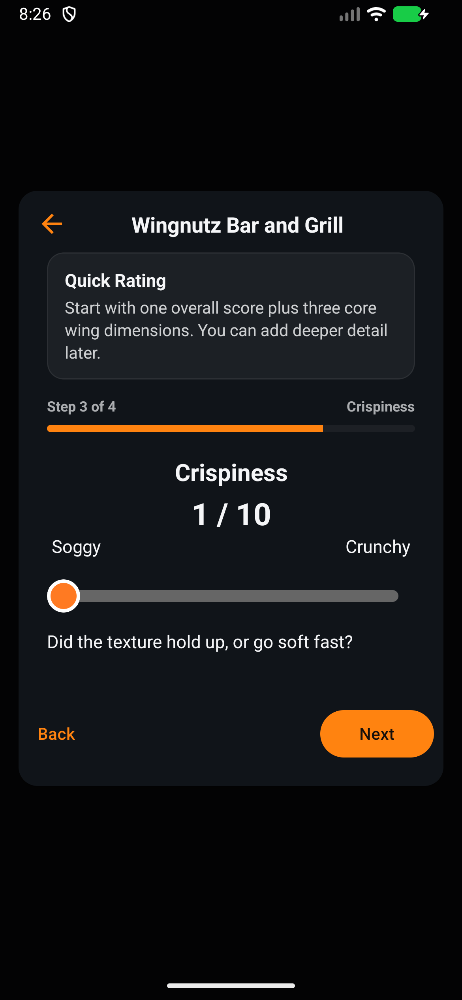](android-E2E-03-rating-crispiness-1.png) [android-E2E-03-rating-crispiness-1.png](android-E2E-03-rating-crispiness-1.png) | 2026-10-22T12:26:23.898Z | Android QA emulator 1170x2532 | **PASS** — Shared step 3 actually remains 1; attempted drag did not change it. Filename corrected from intended 6. | fe173d47f315a2c475de39b44b1e9cc13319a5edef4ef7e077b5228bbb7be094 |
| [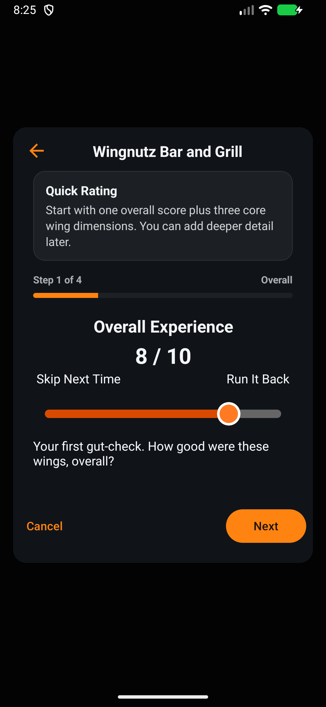](android-E2E-03-rating-overall-8.png) [android-E2E-03-rating-overall-8.png](android-E2E-03-rating-overall-8.png) | 2026-10-22T12:25:54.521Z | Android QA emulator 1170x2532 | **PASS** — Shared step 1, visible overall score 8 and thumb. | 124098fe176382421faff5346c1dd05e679f9a1e6f607d6b80e44ed433d0d85c |
| [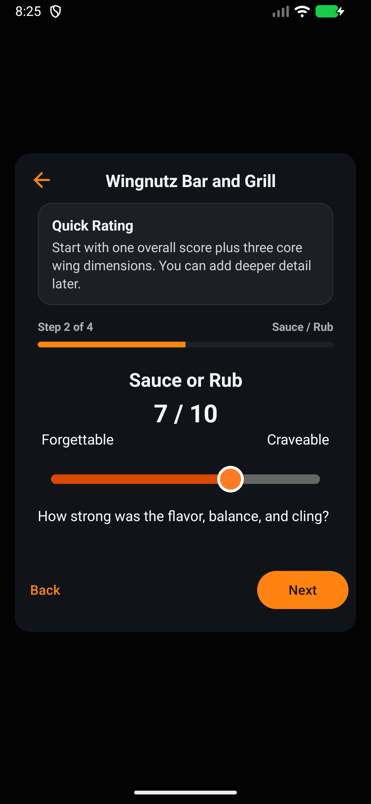](android-E2E-03-rating-sauce-7.png) [android-E2E-03-rating-sauce-7.png](android-E2E-03-rating-sauce-7.png) | 2026-10-22T12:26:14.567Z | Android QA emulator 1170x2532 | **PASS** — Shared step 2, sauce 7 after drag. | bdca5782ee776aa1608f1108b36ba3413c88c034647fb5bc3e5ef06e705ffc1a |
| [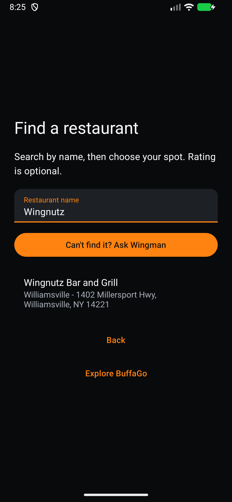](android-E2E-03-restaurant-search.png) [android-E2E-03-restaurant-search.png](android-E2E-03-restaurant-search.png) | 2026-10-22T12:25:42.761Z | Android QA emulator 1170x2532 | **PASS** — Real catalog result, restaurant name and public business address. | dd6cb95580b78e797e667df9be2db8d94f59345b153fcfcc16bf90b2ef544033 |
| [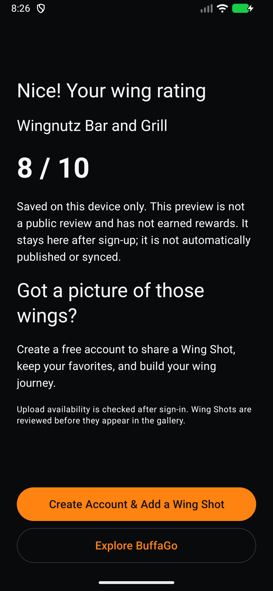](android-E2E-03-score-celebration.png) [android-E2E-03-score-celebration.png](android-E2E-03-score-celebration.png) | 2026-10-22T12:26:33.653Z | Android QA emulator 1170x2532 | **PASS** — Actual 8/10 local-only result, venue, guest photo offer and truthful post-signin availability note. | fd6c686ac9a3369eb910a63f4e4ed8fb8790509a610e7b098fb92d15602a1066 |
|  [android-E2E-04-fallback-home.png](android-E2E-04-fallback-home.png) | 2026-10-22T12:29:59.615Z | Android QA emulator 1170x2532 | **PASS** — Close Wingman then Explore reaches guest Home; no successful discovery claimed. | febc333710691182a0cbe51bc38b796992f58db3b1d6416fa5114ff0a905a471 |
| [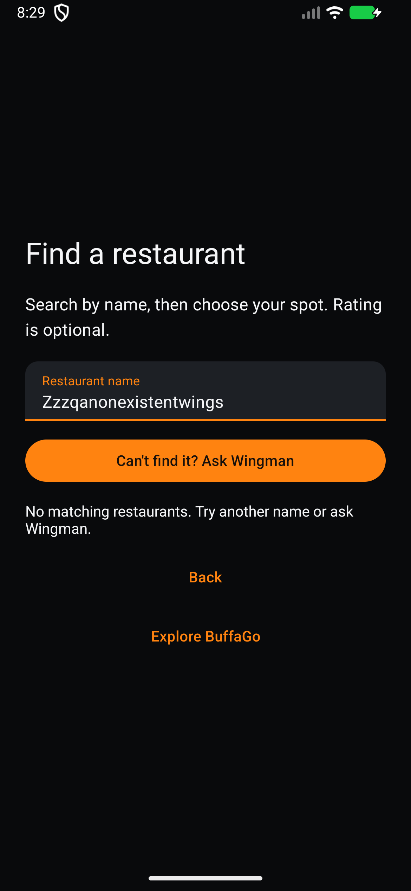](android-E2E-04-no-results.png) [android-E2E-04-no-results.png](android-E2E-04-no-results.png) | 2026-10-22T12:29:27.915Z | Android QA emulator 1170x2532 | **PASS** — No matching catalog result; search/Wingman/Explore remain visible. Whole discovery gate BLOCKED. | 06feb86cae5d505048449acda32740279149fe9274c4e431e78eccacbe7fae4b |
| [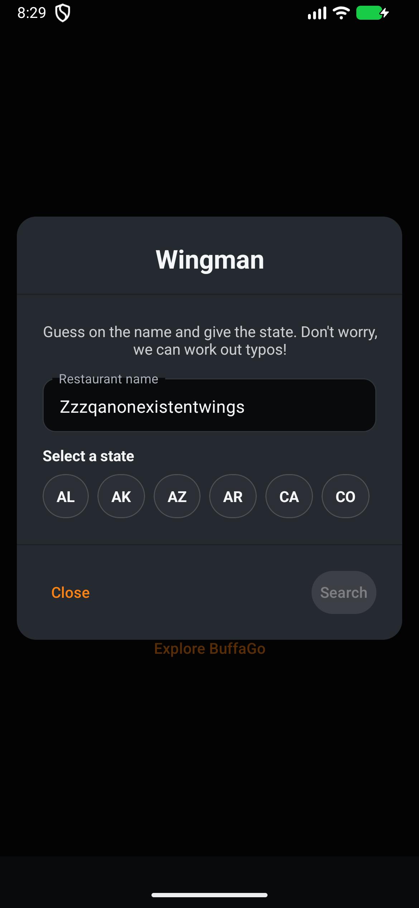](android-E2E-04-wingman-form.png) [android-E2E-04-wingman-form.png](android-E2E-04-wingman-form.png) | 2026-10-22T12:29:50.360Z | Android QA emulator 1170x2532 | **BLOCKED** — Wingman form/state choices only. Search did not establish a result/error; renamed from failure. | 450ea376edad0b0d2cb8bf8b10869610213bda1d5541ca78114472168c142717 |
| [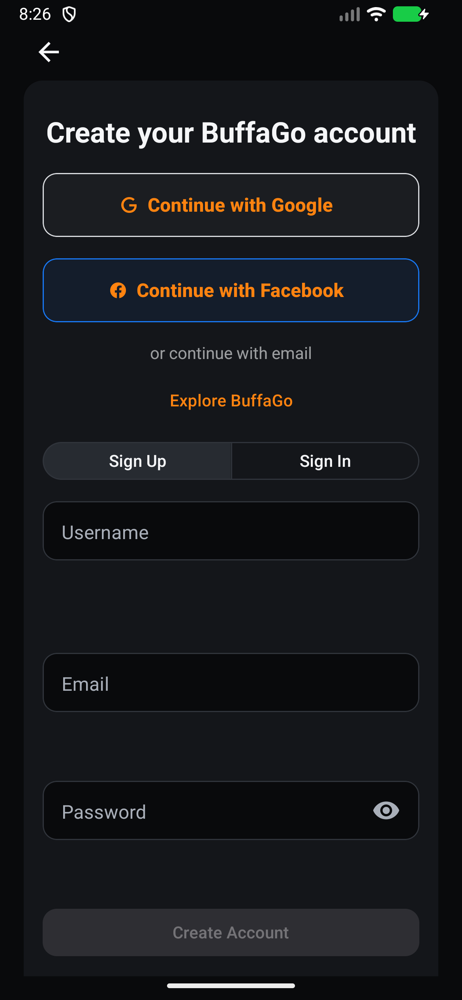](android-E2E-05-auth-screen.png) [android-E2E-05-auth-screen.png](android-E2E-05-auth-screen.png) | 2026-10-22T12:26:40.684Z | Android QA emulator 1170x2532 | **PASS** — Guest photo offer opens empty signup form; no session created. | 7c03b0a1c9183363f2e7902f3c8ca07cb9360725a0d263698b8b85a7070253ec |
| [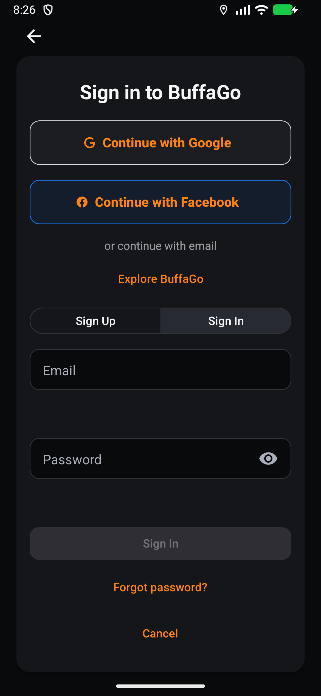](android-E2E-05-signin-screen.png) [android-E2E-05-signin-screen.png](android-E2E-05-signin-screen.png) | 2026-10-22T12:27:06.773Z | Android QA emulator 1170x2532 | **PASS** — Switch to existing-account signin form; no credentials entered or authentication claimed. | 55c523e1fa5d77de99939efb151afdbcc32349ba56913f86ede4a3f16aaa7933 |
|  [android-E2E-10-back-home.png](android-E2E-10-back-home.png) | 2026-10-22T12:27:10.323Z | Android QA emulator 1170x2532 | **PASS** — Hardware Back from auth returns guest Home; real provider cancel gate remains BLOCKED. | 74242870dac9d5aef25df57f07e884e6d6604c85c5cba05e4240d60f6457741c |
|  [android-E2E-10-cold-restart-after-auth-back.png](android-E2E-10-cold-restart-after-auth-back.png) | 2026-10-22T12:27:34.198Z | Android QA emulator 1170x2532 | **PASS** — Cold restart after auth Back returns guest Home; not authenticated E2E-14. | 85544aa452e07689e34d9090179f309f6f3a2b9aaefcf2fc99b57be3402c650e |
|  [android-E2E-10-explore-home.png](android-E2E-10-explore-home.png) | 2026-10-22T12:27:57.802Z | Android QA emulator 1170x2532 | **PASS** — Explicit Explore from reopened auth reaches Home. | 85544aa452e07689e34d9090179f309f6f3a2b9aaefcf2fc99b57be3402c650e |
| [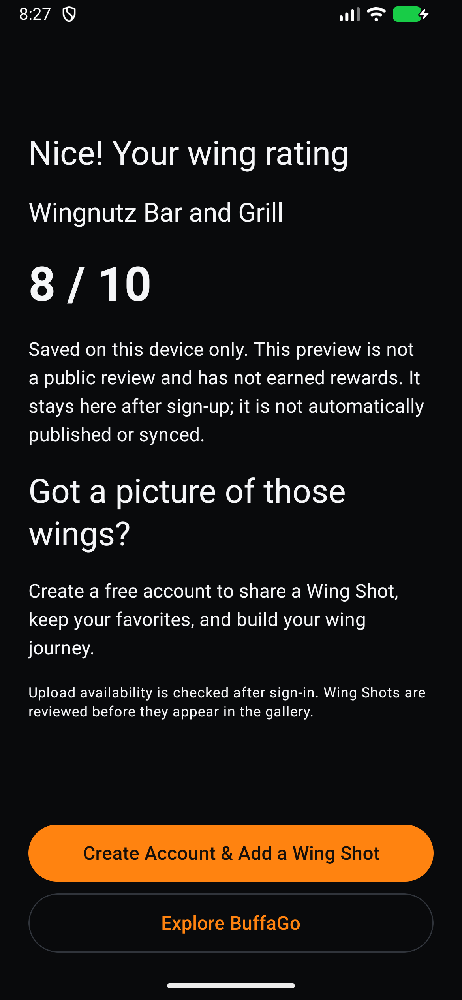](android-E2E-17-restored-preview.png) [android-E2E-17-restored-preview.png](android-E2E-17-restored-preview.png) | 2026-10-22T12:28:00.628Z | Android QA emulator 1170x2532 | **PASS** — Manual onboarding deep-link restores persisted preview, not an automatic reset. Stress gate BLOCKED. | 7859d7b8c5c89abeef80cfadb5886c3f9e7e6bc2ebcf886ef137e69d36741ded |
| [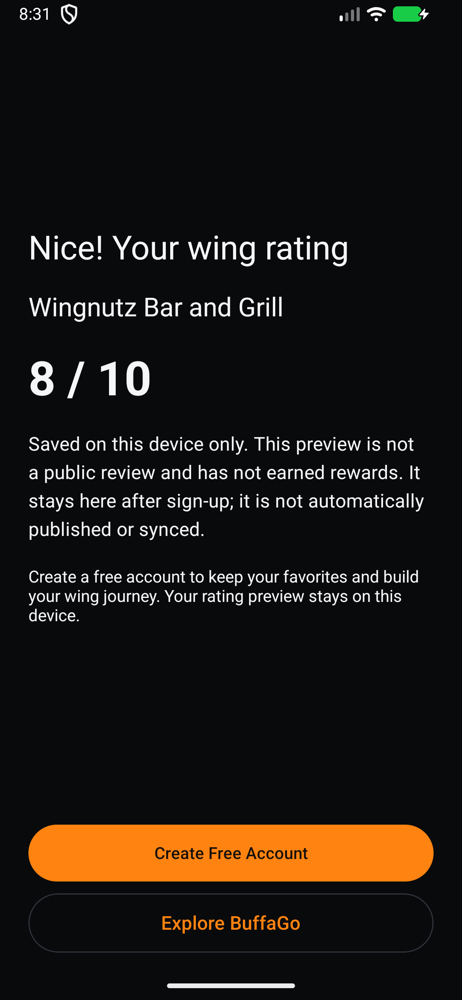](android-E2E-18-invitation-off.png) [android-E2E-18-invitation-off.png](android-E2E-18-invitation-off.png) | 2026-10-22T12:31:57.880Z | Android QA emulator 1170x2532 | **PASS** — V2 on / invitation off: neutral favorites signup, no photo offer. | 17912aefde641de52408d1d9c62e3b021053ed5d021d3903ed6027c4ac5b6a5c |
| [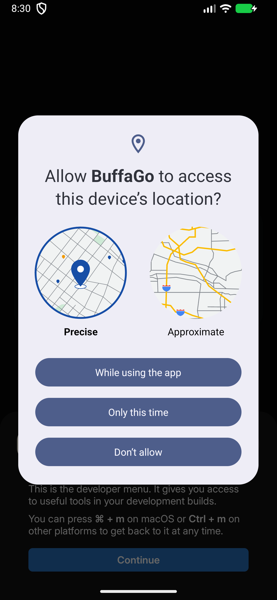](android-E2E-18-legacy-location-prompt.png) [android-E2E-18-legacy-location-prompt.png](android-E2E-18-legacy-location-prompt.png) | 2026-10-22T12:30:42.778Z | Android QA emulator 1170x2532 | **PASS** — V2 off restores legacy location permission request; no personal GPS granted. | 86d2ad47ad617397fa4a5795e48b2da16c4abb7e5c0352895e1325cf63c6b1a2 |
| [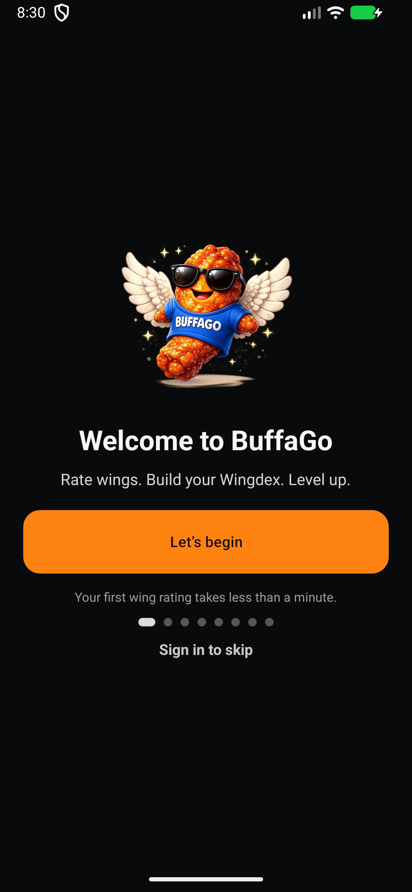](android-E2E-18-legacy-welcome.png) [android-E2E-18-legacy-welcome.png](android-E2E-18-legacy-welcome.png) | 2026-10-22T12:31:17.183Z | Android QA emulator 1170x2532 | **PASS** — V2 off actual legacy Welcome after denying location and dismissing dev menu. | 52810c53ae8eff559948dcf0d2fe47ce60380f767fc12b3094f69c9779f9679f |
| [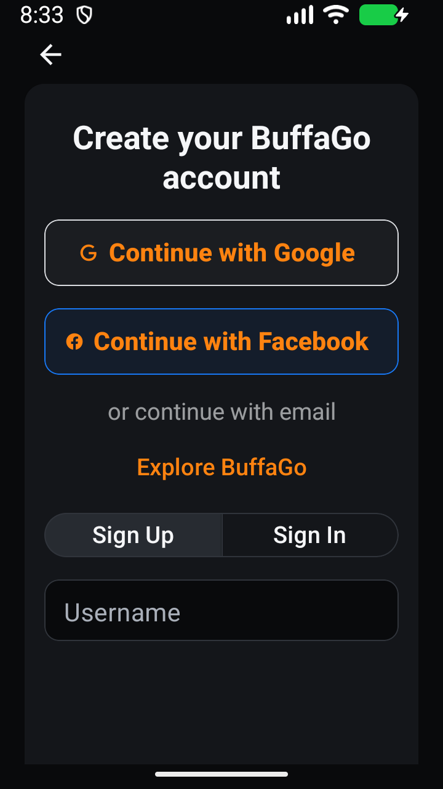](android-E2E-19-fixed-small-auth.png) [android-E2E-19-fixed-small-auth.png](android-E2E-19-fixed-small-auth.png) | 2026-10-22T12:33:20.186Z | Android QA emulator 720x1280, 360x640dp, requested font 1.3 | **PASS** — Tapping fixed CTA opens auth at short viewport; no successful auth claimed. | 2ad4572ab67905ba3af0b4d9317cf7ba419fa9f86cfd0f4a82190ec48fefcdd1 |
| [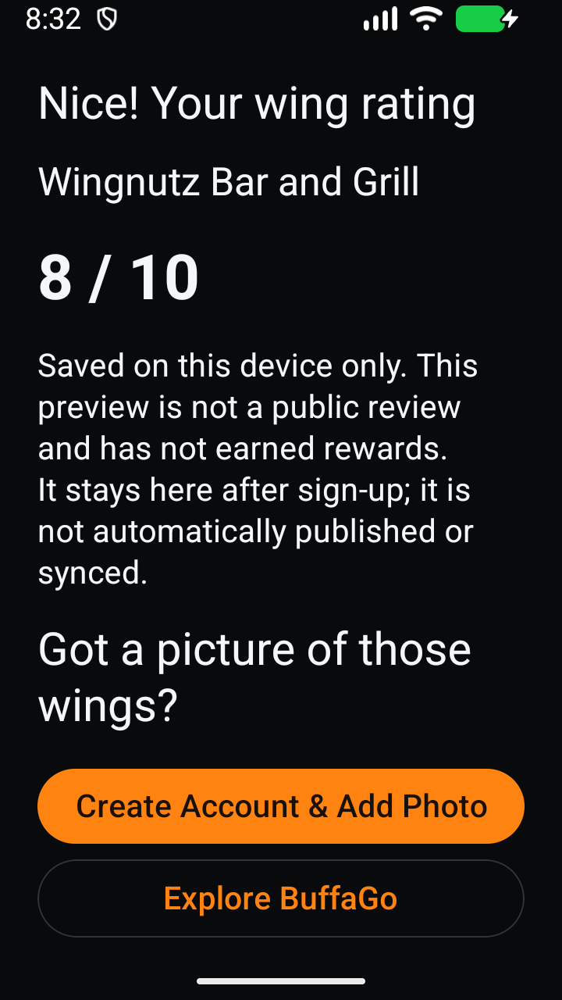](android-E2E-19-fixed-small-cta.png) [android-E2E-19-fixed-small-cta.png](android-E2E-19-fixed-small-cta.png) | 2026-10-22T12:33:01.815Z | Android QA emulator 720x1280, 360x640dp, requested font 1.3 | **PASS** — After fix: full Create Account & Add Photo visible at 360x640dp/font scale 1.3. | 133d74981333083022dd6e4f3f638727229006f77e8d95822b77b5dabe22ef10 |
| [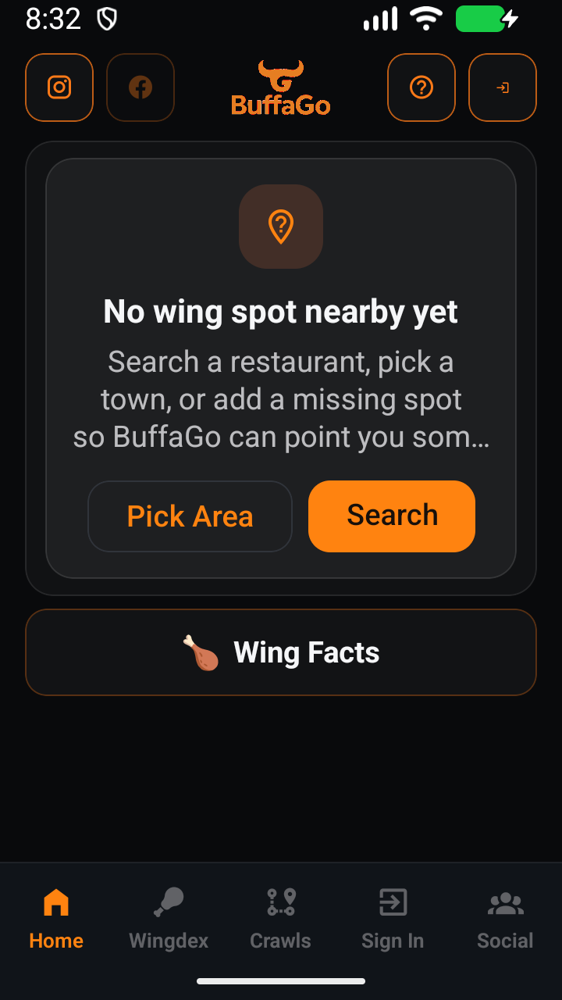](android-E2E-19-fixed-small-home.png) [android-E2E-19-fixed-small-home.png](android-E2E-19-fixed-small-home.png) | 2026-10-22T12:32:58.732Z | Android QA emulator 720x1280, 360x640dp, requested font 1.3 | **PASS** — Guest Home after viewport/fix cold restart; no authenticated continuity claim. | fef86d5e329191bda365356e8b2b15d4f7323d5a7a8377808bac1a67bf12371c |
| [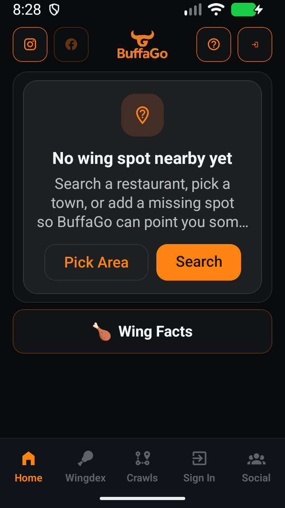](android-E2E-19-small-home.png) [android-E2E-19-small-home.png](android-E2E-19-small-home.png) | 2026-10-22T12:28:43.819Z | Android QA emulator 720x1280, 360x640dp, requested font 1.3 | **PASS** — Guest Home after viewport/fix cold restart; no authenticated continuity claim. | 8e72e18cea163f39f7e4b61f2e34077aa33567ba6e2b7ae43fd53357dddd5995 |
| [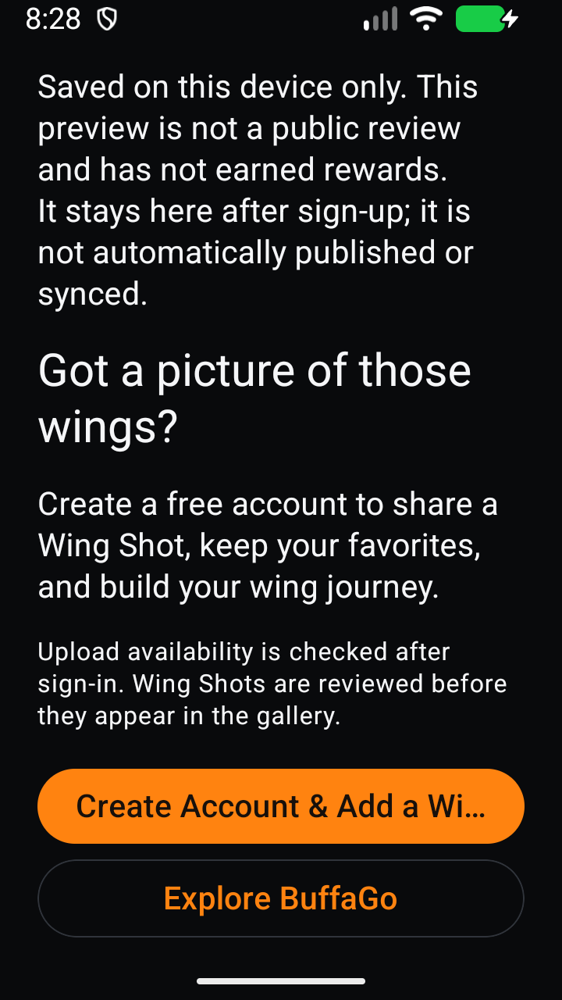](android-E2E-19-small-result-clean-scrolled.png) [android-E2E-19-small-result-clean-scrolled.png](android-E2E-19-small-result-clean-scrolled.png) | 2026-10-22T12:28:49.331Z | Android QA emulator 720x1280, 360x640dp, requested font 1.3 | **FAIL** — Before-fix visual proof: Create Account & Add a Wi…; body can scroll. | 40e9e428753bdb0aa817f45f0927d4bb36bcb3e04d882827bb236ba846976e91 |
| [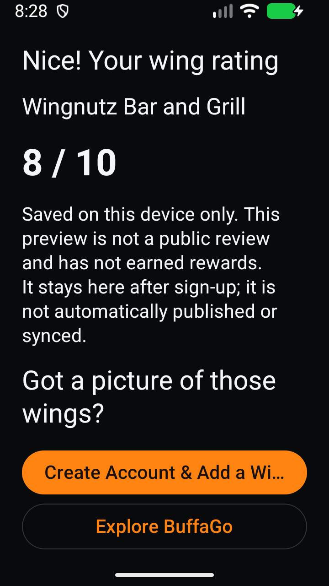](android-E2E-19-small-result-clean.png) [android-E2E-19-small-result-clean.png](android-E2E-19-small-result-clean.png) | 2026-10-22T12:28:46.636Z | Android QA emulator 720x1280, 360x640dp, requested font 1.3 | **FAIL** — Cold restart removes debug warning; original long CTA still truncates. | 9b2f82f711c940b995db525732c7451bda7532529fd3044e69a0894c15fef9a6 |
| [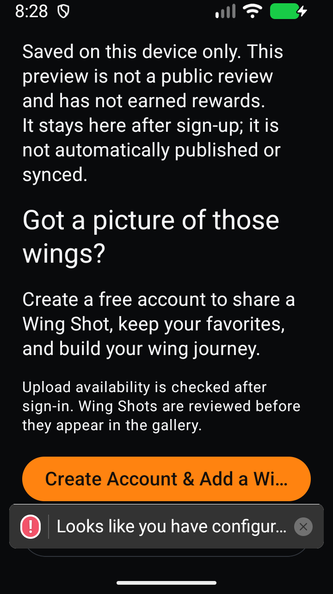](android-E2E-19-small-result-scrolled.png) [android-E2E-19-small-result-scrolled.png](android-E2E-19-small-result-scrolled.png) | 2026-10-22T12:28:23.365Z | Android QA emulator 720x1280, 360x640dp, requested font 1.3 | **FAIL** — Before fix: scrolled result; debug linking warning/CTA truncation retained. | 18b5b88643bc867dfa025da96345a507c88923bac8f1f1cc2e7b7b48dfe87c63 |
| [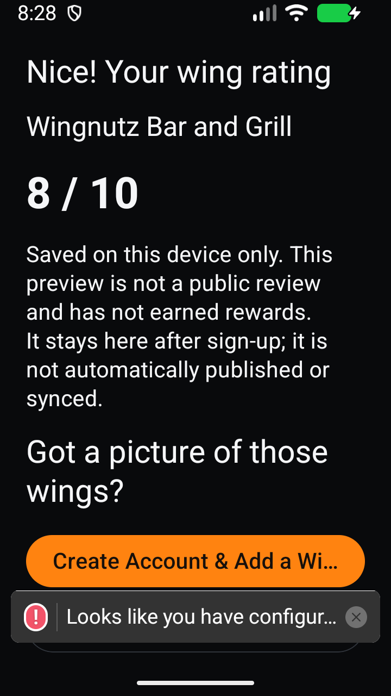](android-E2E-19-small-result.png) [android-E2E-19-small-result.png](android-E2E-19-small-result.png) | 2026-10-22T12:28:20.625Z | Android QA emulator 720x1280, 360x640dp, requested font 1.3 | **FAIL** — Before fix: short result, truncated photo CTA plus display-recreation linking warning. | 07cd8fe94725281a9942047fd236d46fffef11e15eb175c9af0a030a1ecff560 |
|  [android-restored-guest-home.png](android-restored-guest-home.png) | 2026-10-22T12:22:50.769Z | Android QA emulator 1170x2532 | **PASS** — Initial restored guest Home; not fresh onboarding or signed-in proof. | 0948ccec761fa6cebbc53980c13d75e42950fbe275fe07feacc9e19c9ea1e987 |
