# Staging Android native screenshots

38 genuine Android PNGs; 0 iOS. Medium Phone emulator, Android 16/API 36.1, 1170x2532/density 480; installed debug APK 1.0.5/code 6/runtime 1.0.4 and branch JS. All PNGs are native adb screencap bytes. No mocks/generative images. A known synthetic grid was explicitly selected for the real isolated upload; no production/user photos uploaded. Identity-bearing premature capture was moved to ignored private evidence. Renamed before-signup image is the invitation, not the auth form. PASS describes the narrow observation; external OAuth/iOS/delayed confirmation remain BLOCKED.

| Image | UTC | Device/state and proof | SHA256 |
|---|---|---|---|
|  [android-01-guest-welcome.png](android-01-guest-welcome.png) | 2026-10-22T14:36:56.619Z | Android QA emulator — PASS first fresh guest Welcome; real isolated backend, no forced signup. | 2305e864d0ee71580a2818dc50d720b6e7f7aa944ba07021966e33349c544f3d |
| [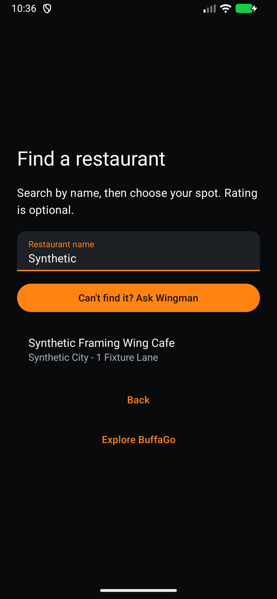](android-02-staging-restaurant-search.png) [android-02-staging-restaurant-search.png](android-02-staging-restaurant-search.png) | 2026-10-22T14:37:11.925Z | Android QA emulator — PASS real REST result for synthetic staging venue. | e5beb808bf1f644c7850e953f5905c62175c77e2907cdabb87cd0f11c9e2ca3d |
| [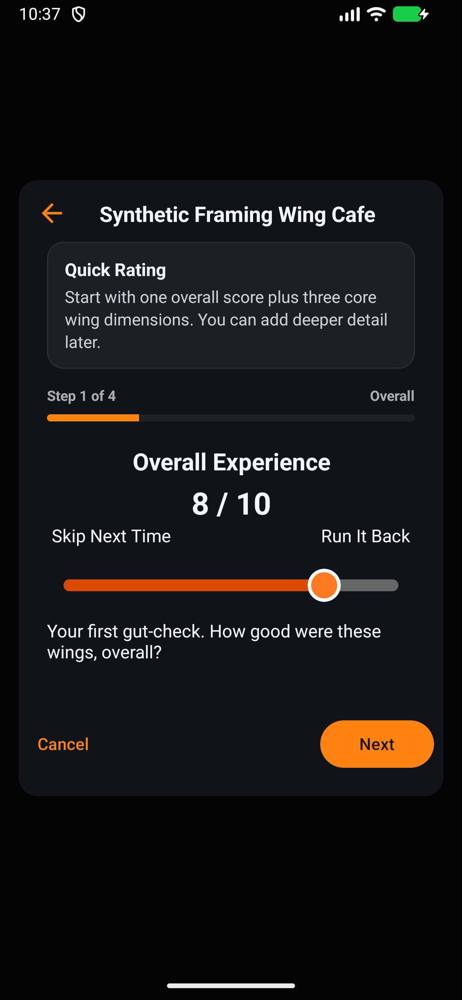](android-03-overall-8.png) [android-03-overall-8.png](android-03-overall-8.png) | 2026-10-22T14:38:15.632Z | Android QA emulator — PASS actual overall slider score 8. | 4f41c9e2825e6c50562805b8cbe7a3088ff1b1879dc1994652eceaa57c1594a9 |
| [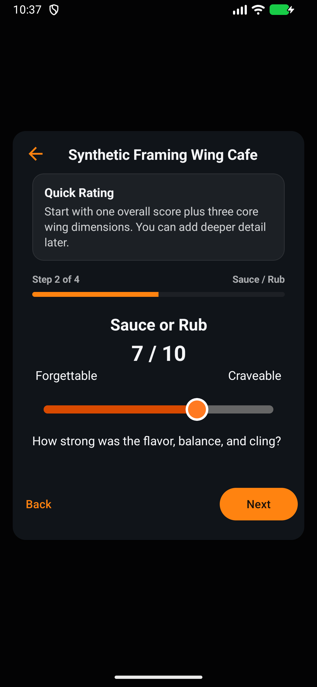](android-04-sauce-7.png) [android-04-sauce-7.png](android-04-sauce-7.png) | 2026-10-22T14:38:23.378Z | Android QA emulator — PASS actual sauce slider score 7. | e64d388a6e789ae0145ea5eac27a60151b730e83536c5adf5919ef9cd4c9fced |
| [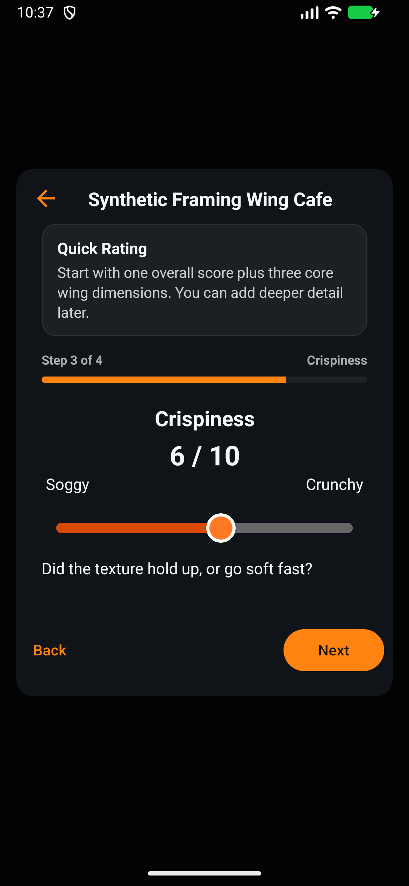](android-05-crispiness-6.png) [android-05-crispiness-6.png](android-05-crispiness-6.png) | 2026-10-22T14:38:31.146Z | Android QA emulator — PASS actual crispiness slider score 6. | 58233de3c96f24dd77e3290bf992d1e9ec8fe7b9135da068d4be2044ca765d49 |
| [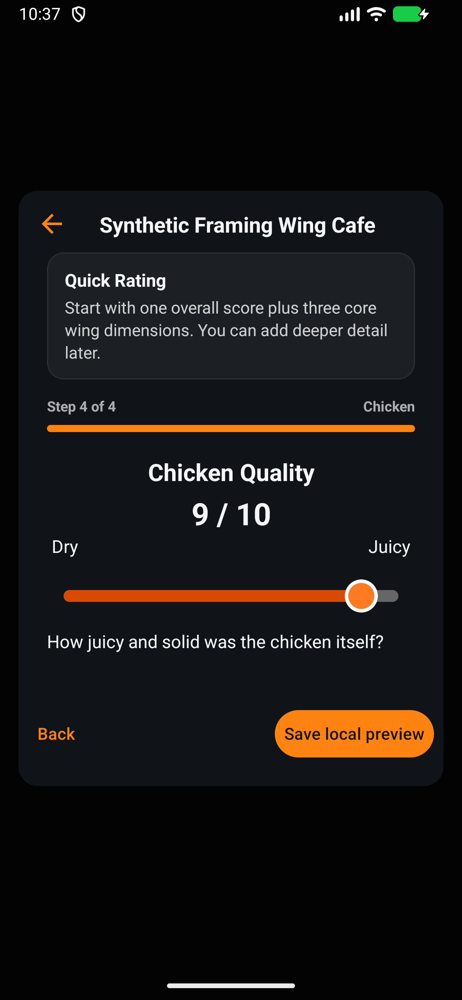](android-06-chicken-9.png) [android-06-chicken-9.png](android-06-chicken-9.png) | 2026-10-22T14:38:38.954Z | Android QA emulator — PASS actual chicken slider score 9. | baa05b5ac821699b5e34ab71bf59904ef545252e146aa75dfaf99d62ebe861c1 |
|  [android-07-local-celebration.png](android-07-local-celebration.png) | 2026-10-22T14:38:45.279Z | Android QA emulator — PASS actual 8/10 celebration and local-only wording. | ef51df5edf6ed429ec72a7a35a2d4b2806bf24dcd276eea92bd923b71f0b0ba1 |
| [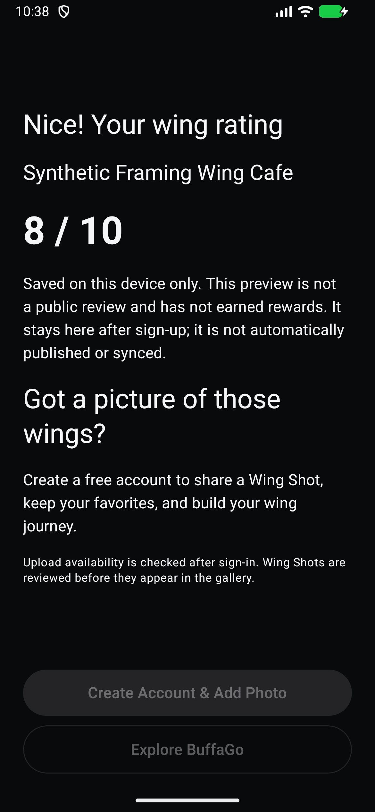](android-08-before-email-signup-invitation.png) [android-08-before-email-signup-invitation.png](android-08-before-email-signup-invitation.png) | 2026-10-22T14:38:51.971Z | Android QA emulator — PASS before-auth invitation; capture preceded auth screen arrival, not a signup-form screenshot. | a77bd3bad1181af7573e6b39829e34c1b19fd919a794c1618a39592d841bf525 |
|  [android-09-after-signup-preselected-uploader.png](android-09-after-signup-preselected-uploader.png) | 2026-10-22T14:39:32.899Z | Android QA emulator — PASS real email signup -> correct preselected uploader. Session independently verified against local GoTrue. | 5f4576066b37001cdd8e4846a3d7a04eb6abb36bd72c91d7047822d3dd4220ca |
| [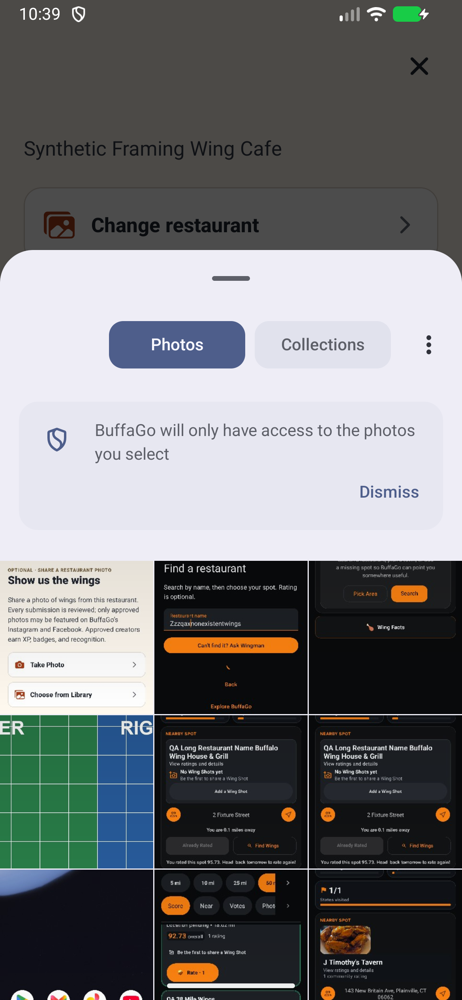](android-10-native-media-picker.png) [android-10-native-media-picker.png](android-10-native-media-picker.png) | 2026-10-22T14:39:51.093Z | Android QA emulator — PASS native scoped picker opens; library contains prior QA screenshots/synthetic media only. | 5d21a0e0e5ef0349b2c325a8d7cb2612103a84ef9b435a0406f178425c8f36c8 |
| [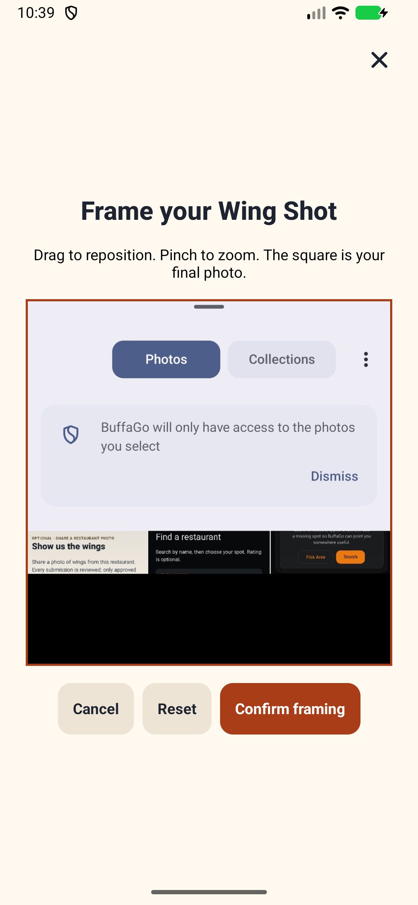](android-11-photo-crop.png) [android-11-photo-crop.png](android-11-photo-crop.png) | 2026-10-22T14:40:06.843Z | Android QA emulator — PASS crop for unintended QA screenshot selection, canceled before confirmation/upload. | 02cf2bcd716bbee58c9aeccaee075b8c4faf07e2f6701f2386677c08d5ef1755 |
| [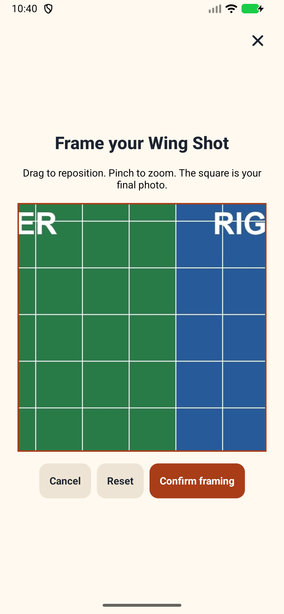](android-12-synthetic-photo-crop.png) [android-12-synthetic-photo-crop.png](android-12-synthetic-photo-crop.png) | 2026-10-22T14:40:43.325Z | Android QA emulator — PASS corrected selection of known synthetic grid; confirmed framing. | bd55efe56748475005c65883e5f5840013d491dd353c5539aedfddbf23defdd5 |
| [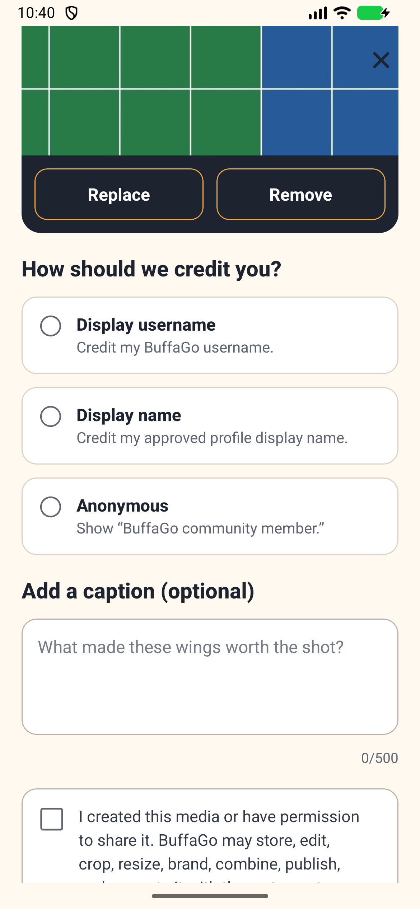](android-13-consent-options.png) [android-13-consent-options.png](android-13-consent-options.png) | 2026-10-22T14:41:08.900Z | Android QA emulator — PASS attribution/consent controls, synthetic preview. | 478b3ea479a02f2803f36baf9fabaadd7d6fe4ae9f8aaf33eff44628415ed939 |
| [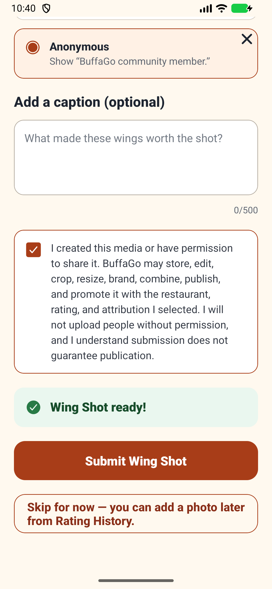](android-14-consented-ready-to-submit.png) [android-14-consented-ready-to-submit.png](android-14-consented-ready-to-submit.png) | 2026-10-22T14:41:32.502Z | Android QA emulator — PASS Anonymous attribution and explicit consent before native submit. | 75d0fbbc9bf4cf6a7d4256db099f8f22e7c72b2784bfc0743c3478a9ed49d802 |
| [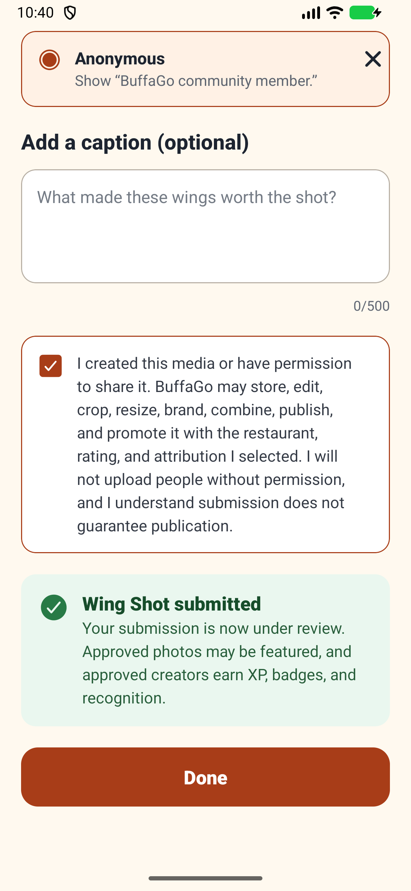](android-15-upload-first-result.png) [android-15-upload-first-result.png](android-15-upload-first-result.png) | 2026-10-22T14:41:38.976Z | Android QA emulator — PASS upload result captured; exact state checked in XML, followed by stable under-review capture. | d56151fbe7d0a40e02701222194aa19dd3387ad7dbe16f6dc27e2425ba4d0882 |
| [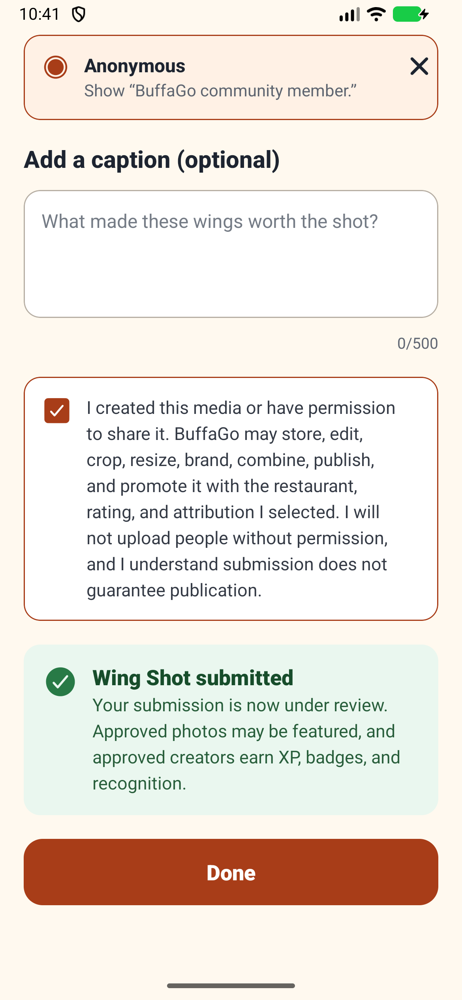](android-16-upload-in-review.png) [android-16-upload-in-review.png](android-16-upload-in-review.png) | 2026-10-22T14:42:22.286Z | Android QA emulator — PASS submitted/under-review UI; server confirms one in_review onboarding photo with null rating ID. | 3a16a2e468b6666a1826eafe706d73dba7763620f463d53e3d925076b6c23d8e |
|  [android-17-signed-in-home.png](android-17-signed-in-home.png) | 2026-10-22T14:42:30.030Z | Android QA emulator — PASS Done exits to signed-in Home. | ba1d09f3578d661024362acded5a9cd2c8977693277ec5ac7caa027e56c2dbbb |
|  [android-18-authenticated-cold-restart-home.png](android-18-authenticated-cold-restart-home.png) | 2026-10-22T14:42:55.627Z | Android QA emulator — PASS process-cold restart after signup/upload acknowledgment reaches signed-in Home, not onboarding/uploader. | 44b1650e9829b0bc4c2c339a648f4990666986f44052e6e5c5bf3e77837042f8 |
| [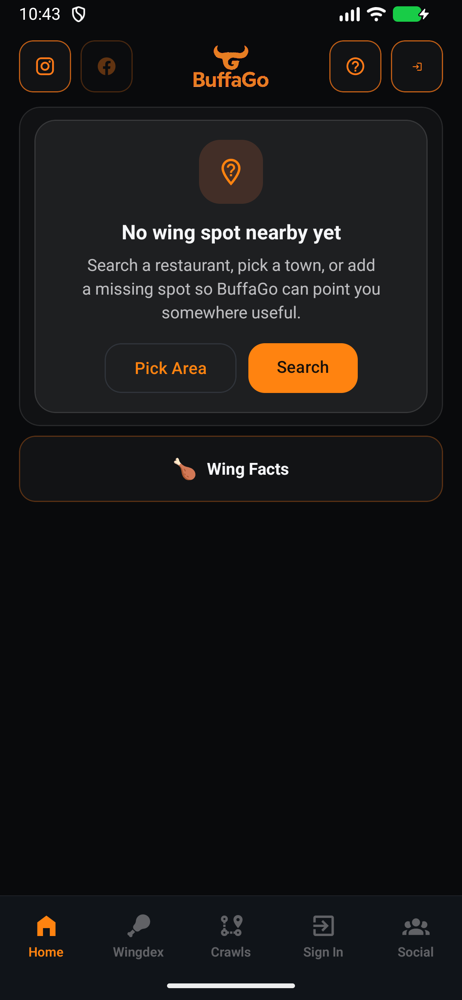](android-19-home-after-signout.png) [android-19-home-after-signout.png](android-19-home-after-signout.png) | 2026-10-22T14:44:21.587Z | Android QA emulator — PASS native profile Sign out, back to guest Home, no Welcome replay. | 6b5d27303eb6049f213364fb516bae9b87a8eb80d225debb6dd03b288ed780fb |
| [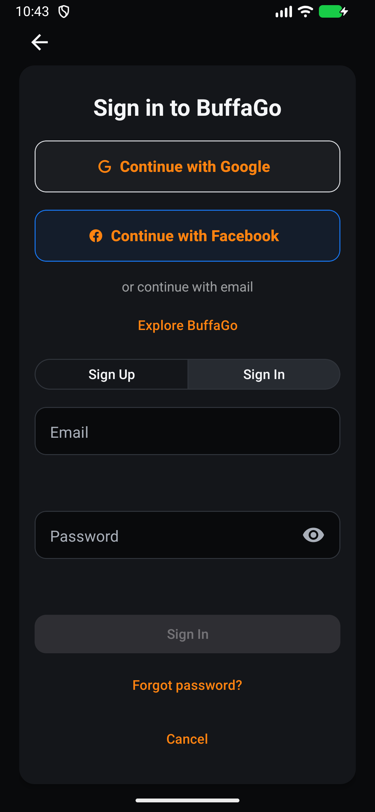](android-20-existing-signin-before-fields.png) [android-20-existing-signin-before-fields.png](android-20-existing-signin-before-fields.png) | 2026-10-22T14:44:39.000Z | Android QA emulator — PASS empty existing-account signin screen after signout. | e108a2e94aec0bcd28cef156c9f61a61d046f48a8df7e884daa002ae9b260125 |
|  [android-21-home-after-signout-signin.png](android-21-home-after-signout-signin.png) | 2026-10-22T14:46:19.042Z | Android QA emulator — PASS signed-in Home after relogin and cold restart. Earlier premature filled-form capture was excluded privately; this is the later recapture. | 021a80e37adae9e69fdef184b13423b0a66193bd228731ffd793f1f6cc0db21a |
| [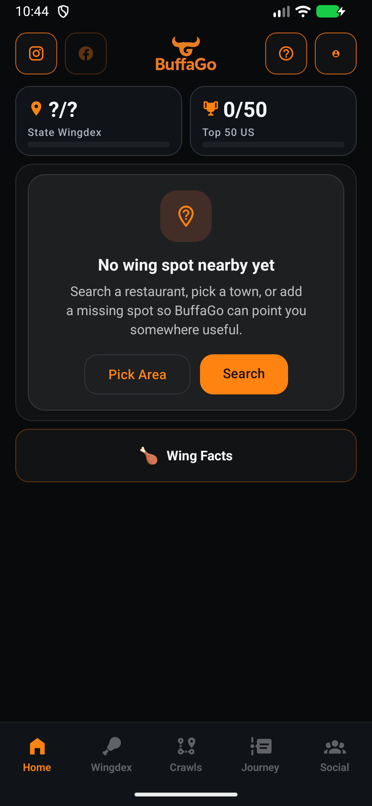](android-22-relogin-cold-restart-home.png) [android-22-relogin-cold-restart-home.png](android-22-relogin-cold-restart-home.png) | 2026-10-22T14:45:30.484Z | Android QA emulator — PASS native password relogin then cold restart remains Home; real restored session independently verified. | 4420e63c4730f6874fdd473e0c4631427dd8ac9ea27e257fe50bf151f1943415 |
| [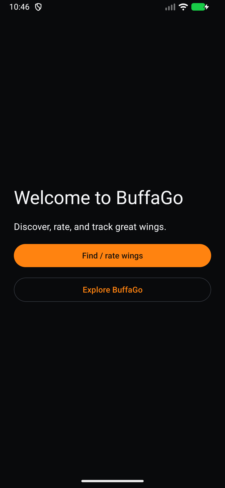](android-23-second-fresh-guest-welcome.png) [android-23-second-fresh-guest-welcome.png](android-23-second-fresh-guest-welcome.png) | 2026-10-22T14:47:00.417Z | Android QA emulator — PASS deliberately cleared disposable app data starts second fresh-guest campaign. | eb559511527e71917494a717d3bca3fcaf2f775a74d1d511ad39d5f3abe9af4b |
| [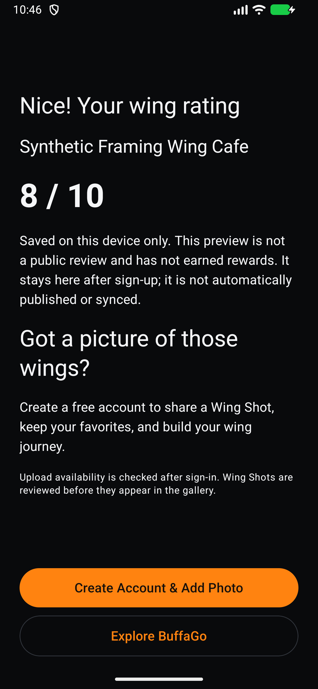](android-24-existing-account-invitation.png) [android-24-existing-account-invitation.png](android-24-existing-account-invitation.png) | 2026-10-22T14:47:25.879Z | Android QA emulator — PASS second guest rating result before signin handoff. | 0f27385f1ee31c997a4591ee4a9d1ca9a53bd41324db38d5f678da06dbf172d9 |
| [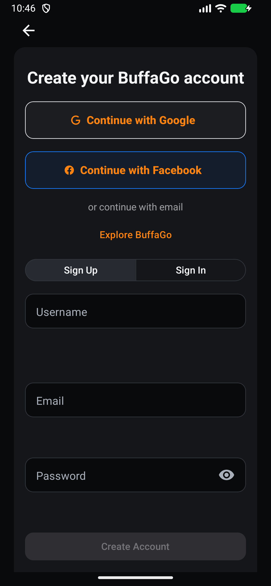](android-25-invitation-before-existing-signin.png) [android-25-invitation-before-existing-signin.png](android-25-invitation-before-existing-signin.png) | 2026-10-22T14:47:33.835Z | Android QA emulator — PASS empty signup-default auth screen before switching to existing-account Sign In; not successful authentication. | 1fc2411a377160c5cb95afc7771acd3b0fad46636b15dce0b2dd2bbe6af35a06 |
| [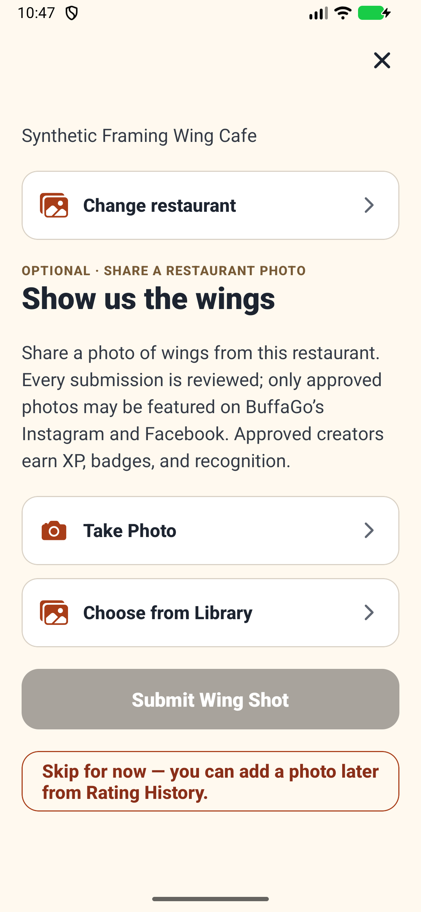](android-26-after-existing-signin-preselected-uploader.png) [android-26-after-existing-signin-preselected-uploader.png](android-26-after-existing-signin-preselected-uploader.png) | 2026-10-22T14:48:24.606Z | Android QA emulator — PASS existing-account password signin from invitation -> correct preselected uploader; no competing Home/onboarding redirect. | 0513ef4bed16ac2145cb3c6638b3af0c44d21bfe732d3e530b2e62ac860c56cc |
|  [android-27-home-after-uploader-cancel.png](android-27-home-after-uploader-cancel.png) | 2026-10-22T14:48:54.782Z | Android QA emulator — PASS explicit uploader close returns signed-in Home; no second submission. | b64410c014fda53d813fcc157f994c3c606bc8ed056912bca4109463ca4a891a |
|  [android-28-existing-signin-cold-restart-home.png](android-28-existing-signin-cold-restart-home.png) | 2026-10-22T14:49:20.528Z | Android QA emulator — PASS restart after existing-account handoff/cancel reaches signed-in Home, no replay. | b64410c014fda53d813fcc157f994c3c606bc8ed056912bca4109463ca4a891a |
|  [android-29-second-signout-guest-home.png](android-29-second-signout-guest-home.png) | 2026-10-22T14:52:16.918Z | Android QA emulator — PASS repeated native signout returns guest Home without Welcome. | bb2606503f22c38f91c5b1ccba210348e011e51d6c6e158cf9a46ce4315bff79 |
| [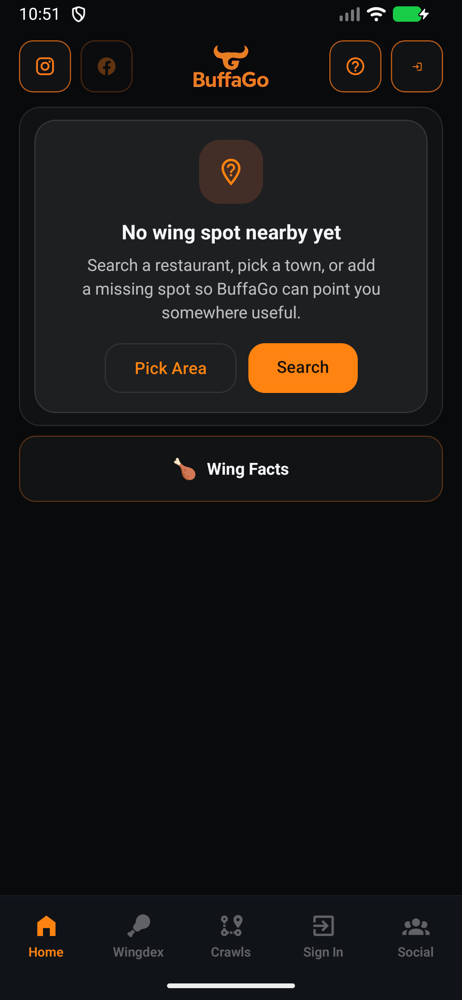](android-30-auth-cancel-home.png) [android-30-auth-cancel-home.png](android-30-auth-cancel-home.png) | 2026-10-22T14:52:31.571Z | Android QA emulator — PASS explicit Explore from auth cancels to usable guest Home. | 3ea08b026374f53c443a5cff7c7fa1955046bc76e2b2b671fe81bc018fce249f |
| [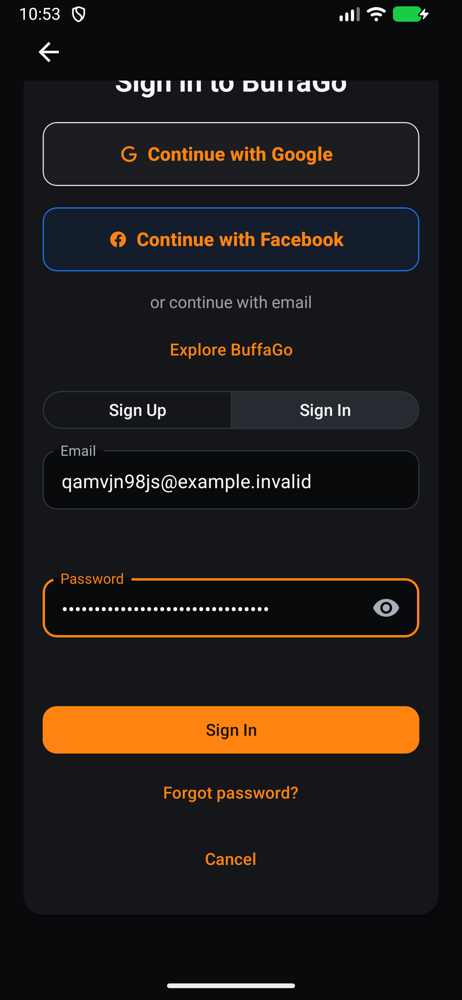](android-31-stable-home-after-relogin.png) [android-31-stable-home-after-relogin.png](android-31-stable-home-after-relogin.png) | 2026-10-22T14:53:56.916Z | Android QA emulator — FAIL before fix: expected stable Home but native content is blank after signin, including after 45s poll. Session verified; cold restart recovered. Filename retains intended state, not a pass. | 096a6cc2050511a45bdc8d63488514516d1149d33cdeabd9fa800cc965124a97 |
|  [android-32-stable-relogin-cold-restart-home.png](android-32-stable-relogin-cold-restart-home.png) | 2026-10-22T14:54:22.817Z | Android QA emulator — PASS recovery after the pre-fix blank screen; this is not proof pre-fix signin navigation passed. | cb1f48ced04e87ec43995125577d80c5fc41768e389eee54067fd3b1eddc212c |
|  [android-33-fixed-signin-stable-home.png](android-33-fixed-signin-stable-home.png) | 2026-10-22T14:57:25.893Z | Android QA emulator — PASS after client fix: ordinary signin dismisses auth modal to stable signed-in Home before restart. | 626402a6427ebb37cea275cab0f35ec7eb976ccf300e7a61b594063b0b75ff84 |
|  [android-34-fixed-signin-cold-restart-home.png](android-34-fixed-signin-cold-restart-home.png) | 2026-10-22T14:57:51.354Z | Android QA emulator — PASS authenticated cold restart after modal fix, no onboarding or uploader replay. | aae112e3ea9f595b74240f4ffd5d46d3707d010250e541075924ba57d266c25a |
| [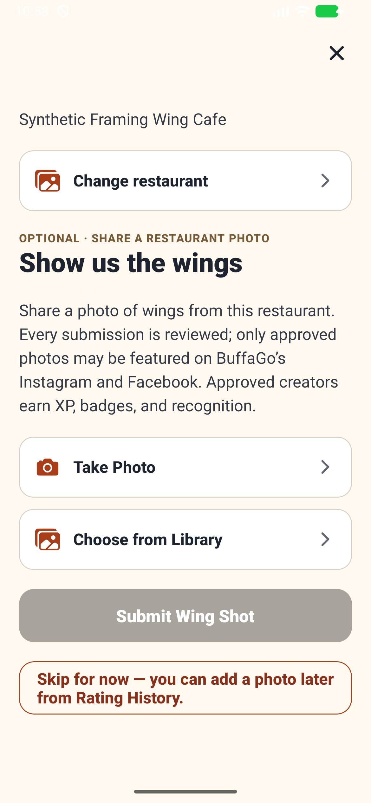](android-35-postfix-existing-signin-preselected-uploader.png) [android-35-postfix-existing-signin-preselected-uploader.png](android-35-postfix-existing-signin-preselected-uploader.png) | 2026-10-22T14:59:21.512Z | Android QA emulator — PASS after fix: guest persisted-preview invitation -> existing password signin -> correct uploader. Preview was deliberately reopened by QA deep-link; not automatic onboarding replay. | d2eab38958c4e7ff9c4064d64cf9f93dc02c77ff466f28b8e3bafb561a0d29f3 |
|  [android-36-postfix-cancel-home.png](android-36-postfix-cancel-home.png) | 2026-10-22T14:59:32.134Z | Android QA emulator — PASS after fix: cancel preselected uploader to signed-in Home, no additional submission. | 7f3675837ffae491acabf1f724b2244959a87d1e7143e6932e671e9910ea5e47 |
|  [android-37-postfix-handoff-cold-restart-home.png](android-37-postfix-handoff-cold-restart-home.png) | 2026-10-22T14:59:57.757Z | Android QA emulator — PASS final post-fix cold restart to signed-in Home; server verifies same account, no pending intent or extra submission. | 5d72454c0a114fa8186598a903f573db50792cd0303f9ba307dc0f1b518bfb54 |
| [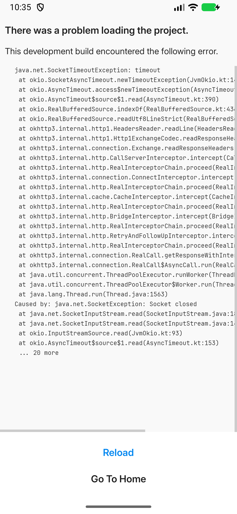](android-startup-before-metro-ready.png) [android-startup-before-metro-ready.png](android-startup-before-metro-ready.png) | 2026-10-22T14:36:21.608Z | Android QA emulator — FAIL startup attempt before Metro was ready. Recovered after manifest/full-bundle readiness; no app ANR. | 78d01a85e9b67760f82fb158cc7837cc0a330fdca7c02432f95615d515b8c538 |
